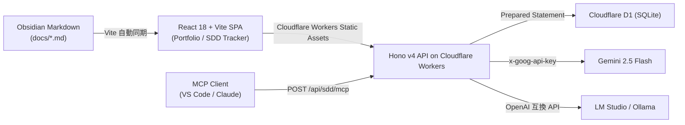

# SDD Progress Tracker & Portfolio / Trip Splitter (`ai-travel-planner`)

**仕様駆動開発（SDD: Spec-Driven Development）** と **Cloudflare フルスタックエッジ構成** で構築した、エンジニア・ポートフォリオ統合 Web アプリ兼 SDD 進捗管理・リモート MCP サーバーのモノレポです。

> 関連リポジトリ: [epaper-dashboard](https://github.com/Ono-L/epaper-dashboard) / [gbf-beginner-bot](https://github.com/Ono-L/gbf-beginner-bot) / [GitHub プロフィール (@Ono-L)](https://github.com/Ono-L)

---

## 1. このリポジトリで実装している 2 つのプロダクト

### A. SDD Progress Tracker & Engineer Portfolio（`main` ブランチ・稼働中）
Obsidian Vault（`docs/`）の Markdown 仕様書を唯一の正本（Single Source of Truth）として、仕様書と実装の乖離を防ぐ進捗管理・ハイブリッド AI 監査・リモート MCP サーバー、および採用担当者向けポートフォリオを **1 つの Cloudflare Worker（無料枠）** で統合配信します。

- **ポートフォリオ画面（未ログインで公開閲覧可能）**
  - 制作プロダクト 4 件の背景・設計工夫・品質/セキュリティ・ADR（技術的意思決定記録）・カテゴリフィルタ・PDF 印刷対応
- **Obsidian 仕様書自動同期（Vite カスタムプラグイン）**
  - `docs/` 配下の Markdown（YAML フロントマター）をファイル監視し、`public/specs-manifest.json` を自動生成
- **ハイブリッド AI 仕様書監査**
  - Google Gemini API（無料枠）とローカル LLM（LM Studio / Ollama の OpenAI 互換 API）を動的に切り替え可能
- **リモート MCP サーバー（`POST /api/sdd/mcp`）**
  - JSON-RPC 2.0 準拠で `tools/list` / `tools/call` を提供し、外部 AI エージェントや内蔵 MCP Playground から疎通可能

### B. Trip Splitter（`archive/trip-splitter-v1` ブランチ・Phase 1 完了・アーカイブ保全）
- DevContainer（Docker）+ pnpm Workspaces + Turborepo v2 上で、`apps/app`（Expo Router v3）+ `apps/api`（Hono v4 RPC + Cloudflare D1 6 テーブル設計 + R2 + Workers Cron 非同期レシート解析）+ `packages/shared`（Zod 共通スキーマ）を構築し、Expo Tunnel 実機検証まで完了。
- **ADR-001（技術的意思決定）**: アプリストア公開の固定費（Apple Developer Program 年額 \$99 USD 等）削減と「URL 共有だけで同行者が即参加できる UX」を優先し、Cloudflare 無料枠での Web 公開路線へピボット（モバイル検証履歴は [`archive/trip-splitter-v1`](https://github.com/Ono-L/ai-travel-planner/tree/archive/trip-splitter-v1) に保全）。

---

## 2. システムアーキテクチャ



---

## 3. セキュリティ・品質設計

- **公開／非公開の境界とセッション認証**:
  - ポートフォリオ画面は公開閲覧可能、SDD 進捗トラッカーおよび `/api/auth/*`・`/api/health` 以外の全 `/api/*` はログイン必須（未認証時は `401 Unauthorized`）。
  - Web Crypto API（`crypto.subtle`）による HMAC-SHA256 署名付き `HttpOnly` / `SameSite=Lax` セッション Cookie 認証、パスワードおよび Bearer トークン検証には SHA-256 ダイジェストの**定数時間比較**を採用。
  - シークレット未設定時はフェイルクローズ（`503` / `401`）で拒否。
- **AI セキュリティ（OWASP LLM01 対策）**:
  - 仕様書テキストを `<spec_input>` タグで隔離・サニタイズし、プロンプトインジェクションを緩和。
  - Gemini API キーは URL クエリではなく `x-goog-api-key` ヘッダー送信＋15 秒タイムアウト制御。
- **型安全・DB 安全**:
  - 全ワークスペースで TypeScript `strict: true`（`any` 禁止）、`packages/shared` の Zod スキーマと Hono RPC によるエンドツーエンド型安全。
  - Cloudflare D1 操作はすべて Prepared Statement を使用。

---

## 4. ディレクトリ構成

```text
ai-travel-planner/
├── .devcontainer/          # Docker / VS Code DevContainer 環境定義
├── AGENTS.md / CLAUDE.md   # AI 仕様駆動開発（SDD）共通ルール
├── docs/                   # SDD 仕様書群 (Obsidian Vault)
│   ├── 01_Requirements/    # ユーザーストーリー・画面仕様書
│   ├── 02_Architecture/    # システム設計・Cloudflare D1 DB スキーマ
│   ├── 03_Rules/           # 技術スタック・コーディング規約
│   ├── 04_Discussions/     # ADR（意思決定記録）・ポートフォリオ履歴・TBD
│   └── sdd-tracker/        # SDD トラッカー & ポートフォリオ仕様書
├── apps/
│   ├── web/                # フロントエンド (React 18 / Vite / PortfolioView / LoginGate / McpPlayground)
│   └── api/                # バックエンド (Hono v4 / Cloudflare Workers Static Assets / D1 / Session Auth / MCP)
└── packages/
    └── shared/             # フロント・バック共通 Zod スキーマ & TypeScript 型定義
```

---

## 5. 技術スタック

| レイヤー | 採用技術 |
| :--- | :--- |
| **Monorepo / 環境** | DevContainer (Docker) / Node.js 20 LTS / TypeScript v5 (`strict: true`) / pnpm v9 / Turborepo v2 |
| **Frontend (`apps/web`)** | React 18 / Vite (カスタム同期プラグイン) / TanStack Query v5 / Zustand / Hono RPC Client |
| **Backend (`apps/api`)** | Hono v4 on Cloudflare Workers / Static Assets / Zod Validator / Web Crypto API |
| **DB / Storage / AI** | Cloudflare D1 (SQLite) / Cloudflare R2 / Gemini 2.5 Flash / LM Studio / Ollama / Remote MCP (JSON-RPC 2.0) |

---

## 6. ローカル検証 & 無料枠デプロイ手順

```bash
# 1. 依存インストール（DevContainer 内推奨）
pnpm install

# 2. 全パッケージ型チェック & ビルド
pnpm typecheck
pnpm build

# 3. Cloudflare Secrets 登録（本番公開時）
pnpm --filter @trip-splitter/api exec wrangler secret put ADMIN_PASSWORD
pnpm --filter @trip-splitter/api exec wrangler secret put SESSION_SECRET

# 4. Cloudflare Workers（Static Assets 統合・無料枠）へデプロイ
pnpm run deploy:free
```
