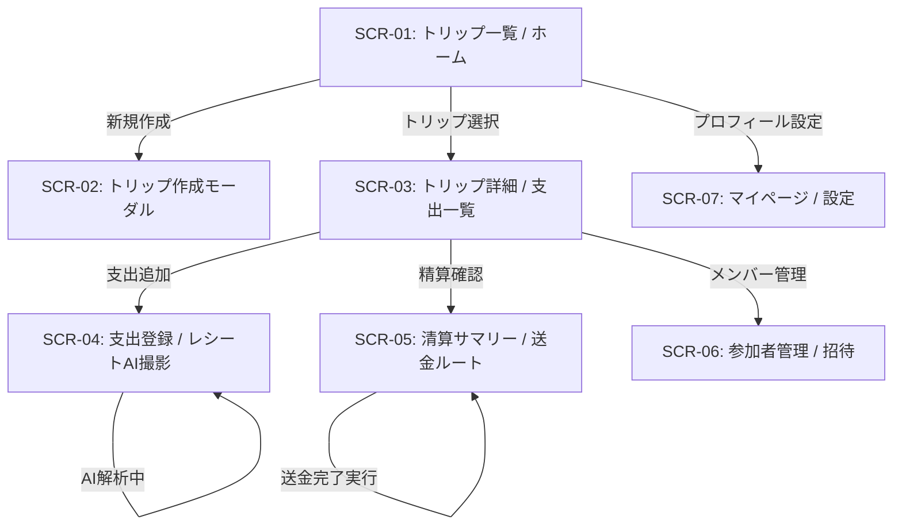

# Screen Specifications (画面仕様書)

> [!info] 概要
> 本ドキュメントは、**Trip Splitter**（モバイルアプリ / Expo）の各画面仕様、遷移フロー、および主要コンポーネントの状態定義を行います。
> AIエージェント (Antigravity) が UI 実装および `apps/app` ディレクトリ構造を迷わず自動生成できるフォーマットで記述されています。

---

## 1. 画面遷移図 (Screen Flow)

---

## 2. ディレクトリ構成対応表 (Expo Router)

| 画面ID | 画面名称 | Expo Router パス | 関連テーブル (`[[database]]`) |
| :--- | :--- | :--- | :--- |
| **SCR-01** | トリップ一覧 | `app/(tabs)/index.tsx` | `trips`, `trip_participants` |
| **SCR-02** | トリップ作成モーダル | `app/trips/new.tsx` | `trips`, `trip_participants` |
| **SCR-03** | トリップ詳細（支出一覧） | `app/trips/[id]/index.tsx` | `trips`, `expenses`, `settlements` |
| **SCR-04** | 支出登録・レシートAI | `app/trips/[id]/expenses/new.tsx` | `expenses`, `expense_splits` |
| **SCR-05** | 清算サマリー・送金 | `app/trips/[id]/settle.tsx` | `settlements`, `expense_splits` |
| **SCR-06** | 参加者管理・招待 | `app/trips/[id]/members.tsx` | `trip_participants`, `users` |
| **SCR-07** | マイページ・設定 | `app/(tabs)/profile.tsx` | `users` |

---

## 3. 画面別詳細仕様

### SCR-01: トリップ一覧 (Dashboard)
- **目的**: 自分が参加している旅行グループの一覧表示と新規作成への導線。
- **表示要素**:
  - ヘッダー: ユーザーアバター (`users.avatar_url`)、通知アイコン。
  - トリップカードリスト: カバー画像 (`trips.cover_image_url`)、タイトル、目的地、期間、自分の現在の貸借状況（例: `+¥3,500` または `-¥1,200`）。
  - Floating Action Button (FAB): 「＋ 新しい旅行を作成」
- **インタラクション・イベント**:
  - カードタップ: `SCR-03 (トリップ詳細)` へ遷移。
  - Analytics Engine イベント: `event: "view_trip_list"`, `click_create_trip`.

---

### SCR-03: トリップ詳細（支出一覧・サマリー）
- **目的**: 選択した旅行内の総支出、個人別バランス、および支出履歴の確認。
- **表示要素**:
  - 上部サマリーエリア:
    - 旅行全体の総支出額 (`SUM(expenses.amount)`)。
    - 自分の現在の精算バランス（立替超過 / 未払い超過）。
  - セグメントタブ: `[ 支出一覧 | 精算ルート | メンバー ]`
  - 支出タイムライン:
    - 日付ごとの支出カード（タイトル、支払者名、金額、カテゴリバッジ、レシート添付有無アイコン）。
    - AI解析ステータスインジケーター (`pending`: 処理中スピナー, `completed`: チェックマーク)。
- **アクション**:
  - FAB: 「＋ 支出を追加」 → `SCR-04` へ遷移。
  - 「清算する」ボタン → `SCR-05` へ遷移。

---

### SCR-04: 支出登録・レシートAI撮影 (Expense Entry & OCR)
- **目的**: 立替費用の手動入力、またはレシート画像撮影による自動入力。
- **表示要素**:
  - **入力フォーム**:
    - 支出タイトル (例: 「夕食代」「レンタカー」)
    - 支払金額 (`amount`) & 通貨単位 (`currency`)
    - 支払者 (`payer_user_id`) 選択ドロップダウン
    - 負担者分割オプション:
      - `[ 均等分割 (Equally) | 個別金額 (Custom) | 傾斜比率 (Ratio) ]`
      - 参加者ごとのチェックボックスと入力ボックス (`expense_splits`)
  - **レシート AI カメラエリア**:
    - 「カメラ起動 / 画像選択」ボタン (Cloudflare R2 へ直接アップロード)。
    - アップロード完了後、Gemini 1.5 Flash の解析状況を表示 (`ai_analysis_status`)。
    - 解析成功時: タイトル・金額・カテゴリをフォームへ自動補完。
- **バリデーション規約**:
  - 支出金額 > 0。
  - 各負担者の `amount` の合計が、全体の `amount` と誤差 0 で一致すること。

---

### SCR-05: 清算サマリー・送金計算 (Settlement Overview)
- **目的**: 複雑な立替関係を相殺し、「誰が誰にいくら払えばよいか」の最小送金ルートを算出・記録する。
- **表示要素**:
  - 最小精算ルートリスト (例: 「Aさん → Bさんへ ¥4,200 送金」)。
  - 「送金完了として記録」ボタン。
- **モーダル動作**:
  - 送金完了記録ボタンタップ時: 送金確認ダイアログ表示。
  - 確定時: `settlements` テーブルにレコード挿入 (`payer_user_id`, `payee_user_id`, `amount`)。
  - クラッカーアニメーション & 最新バランスの再計算更新。

---

### SCR-06: 参加者管理・招待 (Member Management)
- **目的**: メンバーの追加（ディープリンク / QRコード）およびロール設定。
- **表示要素**:
  - 現在の参加者リスト (アバター、名前、ロール `admin / member / guest`)。
  - 招待用 7桁グループコード & QRコード表示エリア。
  - 「招待リンクを共有 (Share Sheet)」ボタン。
  - ゲスト参加者（非アプリユーザー）のダミー作成フォーム。

---

## 4. 状態管理 & 通信ガイドライン (For Antigravity)

> [!code] フロントエンド実装ルール
> - **Server State**: `TanStack Query (React Query)` を使用。Hono RPC (`client.api.trips.$get()`) と組み合わせて完全型安全にデータフックを作成すること。
> - **Client State**: 画面跨ぎのUI状態（レシート撮影のローカルキャッシュ等）は `Zustand` を使用。
> - **UI Component**: `React Native Reanimated` + `NativeWind (Tailwind)` によるコンポーネント実装。
> - **エラー表示**: Toast UI を使用し、ネットワークエラーやバリデーションエラーを非非破壊的に通知。
