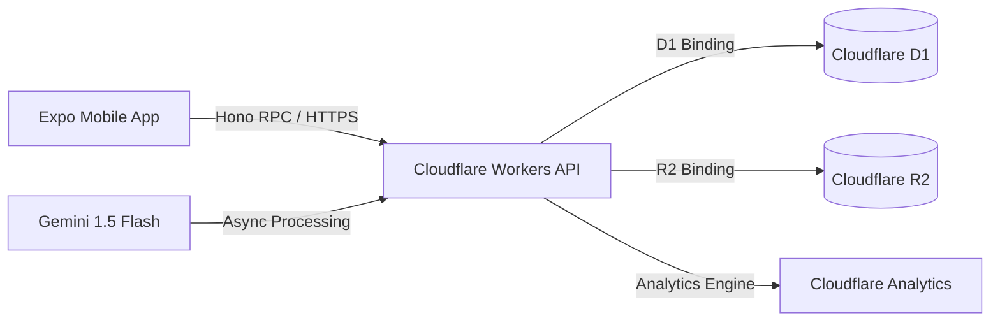

# User Stories & Scenario Specifications

> [!info] 概要
> 本ドキュメントは、**Trip Splitter** におけるユーザー行動シナリオ（User Stories）および受入条件（Acceptance Criteria）を定義します。
> AIエージェント (Antigravity) が画面実装・APIエンドポイント設計・ドメインロジック構築を行う際の振る舞い基準となります。

---

## 1. ユーザーペルソナ定義

| ペルソナ | 役割 | 想定行動・課題 |
| :--- | :--- | :--- |
| **オーガナイザー (Admin)** | 旅行の発起人・幹事 | 旅行グループの作成、メンバーの招待、全体の精算完了の取りまとめを行う。 |
| **メンバー (Member)** | 旅行参加者 | 立替支出の登録、レシート画像のアップロード、自分宛ての精算額の確認・送金を行う。 |
| **ゲスト (Guest)** | アプリ非登録の同行者 | アプリをインストールしていないが、割り勘の人数・負担額計算に含める対象者。 |

---

## 2. エピック別 ユーザーストーリー

### Epic 1: 旅行グループの作成・管理 & メンバー招待

#### US-101: 旅行グループの新規作成
- **ユーザー要件**: **オーガナイザーとして**、旅行のタイトル・目的地・日程・基本通貨（JPY, USD等）を設定して旅行グループを作成したい。**それにより**、グループ内での立替管理を開始できる。
- **受入条件 (Acceptance Criteria)**:
  - [ ] タイトルは必須入力（1文字以上50文字以内）。
  - [ ] 作成と同時に、作成したユーザーが `role = 'admin'` として `trip_participants` に自動登録されること。
  - [ ] カバー画像が未指定の場合はデフォルト画像が設定されること。
- **関連データモデル**: `trips`, `trip_participants`
- **参照設計**: `[[database#3-sql-ddl-cloudflare-d1--sqlite-互換]]`

#### US-102: 招待リンク・QRコードによるメンバー追加
- **ユーザー要件**: **オーガナイザーとして**、グループ共有用の招待URL/QRコードを発行・共有したい。**それにより**、同行者を簡単にグループへ参加させられる。
- **受入条件 (Acceptance Criteria)**:
  - [ ] 既存のグループメンバーが参加リンクをタップすると、自動的に `role = 'member'` で登録される。
  - [ ] 同一ユーザーが重複参加しないよう、`UNIQUE(trip_id, user_id)` 制約により制御される。

---

### Epic 2: 支出（立替）の登録 & 割り勘分配

#### US-201: 立替支出の登録（均等割・傾斜割）
- **ユーザー要件**: **メンバーとして**、誰が・何に・いくら支払ったか（立替）を登録し、誰で割り勘するかを指定したい。**それにより**、正確な個人負担額を記録できる。
- **受入条件 (Acceptance Criteria)**:
  - [ ] 支払者 (`payer_user_id`)、金額 (`amount`)、項目名 (`title`) は必須。
  - [ ] **均等分割**: 対象メンバーを選択すると、`金額 ÷ 対象人数` が自動計算され `expense_splits` に保存される。端数処理（切り捨て/切り上げ）のルールが固定化されていること。
  - [ ] **個別金額指定（傾斜割）**: メンバーごとに任意の負担額を手動指定でき、合計額が `expenses.amount` と一致すること。
- **関連データモデル**: `expenses`, `expense_splits`

#### US-202: 支出の編集・削除
- **ユーザー要件**: **立替の登録者（またはAdmin）として**、入力ミスがあった支出データを修正・削除したい。**それにより**、精算トラブルを防げる。
- **受入条件 (Acceptance Criteria)**:
  - [ ] `expenses` レコードの削除時、関連する `expense_splits` レコードが `ON DELETE CASCADE` により自動削除されること。
  - [ ] 精算完了済みの旅行では、過去支出の変更時に警告が表示されること。

---

### Epic 3: レシート AI 解析 (Gemini 1.5 Flash)

#### US-301: レシート撮影・AI自動読み取り
- **ユーザー要件**: **メンバーとして**、紙のレシートをカメラ撮影/画像アップロードするだけで、支払額・店舗名・カテゴリを自動入力したい。**それにより**、手動入力の手間を省ける。
- **受入条件 (Acceptance Criteria)**:
  - [ ] 選択された画像ファイルが Cloudflare R2 にアップロードされ、`receipt_image_url` が生成されること。
  - [ ] アップロード後、`ai_analysis_status` が `'pending'` に更新され、AI解析非同期バッチ（または Worker）が起動すること。
  - [ ] 解析完了後、`ai_summary` に抽出結果（金額・日付・カテゴリ推論）が格納され、フォームに自動補完されること。

---

### Epic 4: 割り勘計算・清算（Settlements）

#### US-401: 旅行全体の差額サマリー・最適化精算ルートの閲覧
- **ユーザー要件**: **参加メンバーとして**、旅行中の全員の立替・負担状況から「誰が誰にいくら払えば精算完了か」の最適ルートを確認したい。**それにより**、送金回数を最小限にして清算できる。
- **受入条件 (Acceptance Criteria)**:
  - [ ] 各ユーザーの `総支払額 (expenses)` と `総負担額 (expense_splits)` の差額（貸し借り balance）が正しく計算されること。
  - [ ] 複雑な複数人間の貸し借りを相殺し、送金回数を最小化するロジック（例: 最小全域木 / 貪欲法）で精算リストが表示されること。

#### US-402: 精算完了（送金完了）の記録
- **ユーザー要件**: **精算金の支払者として**、指定相手への送金完了（現金手渡し含む）をアプリ上で記録したい。**それにより**、清算済み状態へ遷移できる。
- **受入条件 (Acceptance Criteria)**:
  - [ ] `settlements` テーブルに `payer_user_id`, `payee_user_id`, `amount`, `settled_at` が記録されること。
  - [ ] 残高（未清算額）から記録された精算額が減算反映されること。

---

## 3. 非機能要件・制約ルール (Non-Functional Requirements)

1. **オフライン考慮（レジリエンス）**:
   - 電波が不安定な旅行先（山間部や海外）でも支出の仮登録が可能であり、オンライン復帰時に D1 へ同期される設計を考慮する。
2. **パフォーマンス・レスポンス**:
   - D1 へのクエリは最適化されたインデックス（`idx_expenses_trip` 等）を使用し、一覧取得 API は 200ms 以内にレスポンスを返すこと。
3. **データ完全性**:
   - 割り勘の個別負担額合計（`SUM(expense_splits.amount)`）は、必ず親支出額（`expenses.amount`）と一致させる（バリデーションエラーを返却）。
