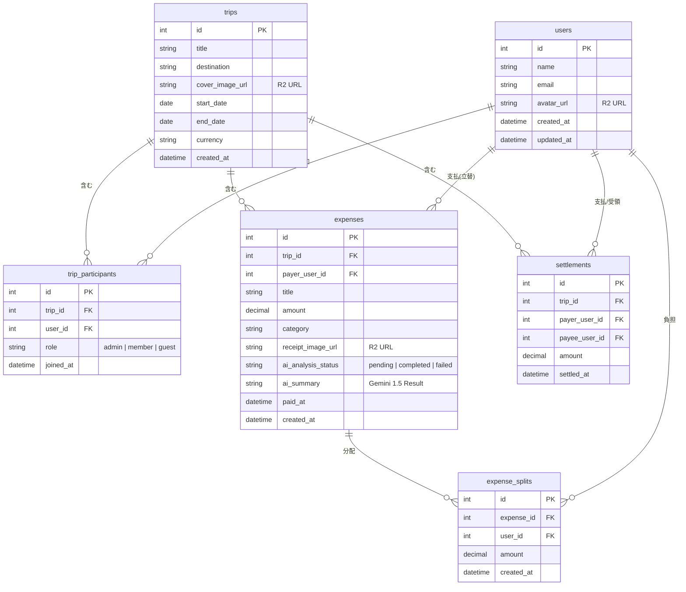

# Database Schema Specification (Cloudflare D1)

> [!info] 概要
> 本ドキュメントは、**Trip Splitter**（旅行立替・精算管理アプリ）における Cloudflare D1 (SQLite互換) のデータベース構造および ER 図を定義します。
> Obsidian 内でのハイパーリンク (`[[tech_stack]]` 等) および AIエージェント (Antigravity) への指示に最適化されています。

---

## 1. アーキテクチャ & 外部サービス連携

> [!note] コンポーネント役割分担
> - **Cloudflare Analytics Engine**: 画面遷移やボタンタップ等のアクセスログは D1 から完全除外して直接送信（D1 の負荷軽減・テーブル廃止）。
> - **Cloudflare R2**: 画像データ実体（アバター、カバー画像、レシート画像）は R2 に格納し、D1 には URL / オブジェクトキーのみ保持 (`*_url`)。
> - **Gemini 1.5 Flash (Batch)**: レシート画像解析結果は `expenses.ai_analysis_status` および `expenses.ai_summary` に反映。

---

## 2. ER 図 (Mermaid)



---

## 3. SQL DDL (Cloudflare D1 / SQLite 互換)

```sql
-- ========================================================
-- Trip Splitter D1 Database Schema
-- ========================================================

-- 1. Users
CREATE TABLE IF NOT EXISTS users (
    id INTEGER PRIMARY KEY AUTOINCREMENT,
    name TEXT NOT NULL,
    email TEXT NOT NULL UNIQUE,
    avatar_url TEXT, -- Cloudflare R2 URL
    created_at DATETIME DEFAULT CURRENT_TIMESTAMP,
    updated_at DATETIME DEFAULT CURRENT_TIMESTAMP
);

-- 2. Trips
CREATE TABLE IF NOT EXISTS trips (
    id INTEGER PRIMARY KEY AUTOINCREMENT,
    title TEXT NOT NULL,
    destination TEXT,
    cover_image_url TEXT, -- Cloudflare R2 URL
    start_date DATE,
    end_date DATE,
    currency TEXT DEFAULT 'JPY',
    created_at DATETIME DEFAULT CURRENT_TIMESTAMP
);

-- 3. Trip Participants (Junction Table)
CREATE TABLE IF NOT EXISTS trip_participants (
    id INTEGER PRIMARY KEY AUTOINCREMENT,
    trip_id INTEGER NOT NULL,
    user_id INTEGER NOT NULL,
    role TEXT NOT NULL CHECK(role IN ('admin', 'member', 'guest')) DEFAULT 'member',
    joined_at DATETIME DEFAULT CURRENT_TIMESTAMP,
    FOREIGN KEY (trip_id) REFERENCES trips(id) ON DELETE CASCADE,
    FOREIGN KEY (user_id) REFERENCES users(id) ON DELETE CASCADE,
    UNIQUE(trip_id, user_id)
);

-- 4. Expenses (Payer Record)
CREATE TABLE IF NOT EXISTS expenses (
    id INTEGER PRIMARY KEY AUTOINCREMENT,
    trip_id INTEGER NOT NULL,
    payer_user_id INTEGER NOT NULL,
    title TEXT NOT NULL,
    amount DECIMAL(12, 2) NOT NULL,
    category TEXT,
    receipt_image_url TEXT, -- Cloudflare R2 URL
    ai_analysis_status TEXT CHECK(ai_analysis_status IN ('pending', 'completed', 'failed')) DEFAULT NULL,
    ai_summary TEXT, -- Gemini 1.5 Flash レシート解析データ
    paid_at DATETIME NOT NULL DEFAULT CURRENT_TIMESTAMP,
    created_at DATETIME DEFAULT CURRENT_TIMESTAMP,
    FOREIGN KEY (trip_id) REFERENCES trips(id) ON DELETE CASCADE,
    FOREIGN KEY (payer_user_id) REFERENCES users(id) ON DELETE RESTRICT
);

-- 5. Expense Splits (Individual Burden)
CREATE TABLE IF NOT EXISTS expense_splits (
    id INTEGER PRIMARY KEY AUTOINCREMENT,
    expense_id INTEGER NOT NULL,
    user_id INTEGER NOT NULL,
    amount DECIMAL(12, 2) NOT NULL,
    created_at DATETIME DEFAULT CURRENT_TIMESTAMP,
    FOREIGN KEY (expense_id) REFERENCES expenses(id) ON DELETE CASCADE,
    FOREIGN KEY (user_id) REFERENCES users(id) ON DELETE CASCADE,
    UNIQUE(expense_id, user_id)
);

-- 6. Settlements (Inter-user Payment Resolution)
CREATE TABLE IF NOT EXISTS settlements (
    id INTEGER PRIMARY KEY AUTOINCREMENT,
    trip_id INTEGER NOT NULL,
    payer_user_id INTEGER NOT NULL, -- 送金者
    payee_user_id INTEGER NOT NULL, -- 受領者
    amount DECIMAL(12, 2) NOT NULL,
    settled_at DATETIME DEFAULT CURRENT_TIMESTAMP,
    FOREIGN KEY (trip_id) REFERENCES trips(id) ON DELETE CASCADE,
    FOREIGN KEY (payer_user_id) REFERENCES users(id) ON DELETE RESTRICT,
    FOREIGN KEY (payee_user_id) REFERENCES users(id) ON DELETE RESTRICT
);

-- ========================================================
-- Indexes
-- ========================================================
CREATE INDEX IF NOT EXISTS idx_trip_participants_user ON trip_participants(user_id);
CREATE INDEX IF NOT EXISTS idx_expenses_trip ON expenses(trip_id);
CREATE INDEX IF NOT EXISTS idx_expense_splits_user ON expense_splits(user_id);
CREATE INDEX IF NOT EXISTS idx_settlements_trip ON settlements(trip_id);
```

---

## 4. テーブル役割まとめ

> [!summary] データフロー解説
> - **立替発生時**: `expenses` に合計支払額と支払者を保存し、`expense_splits` に参加メンバーごとの負担額（割り勘データ）をレコード化。
> - **レシート解析時**: `expenses.receipt_image_url` に画像パスを登録後、非同期で Gemini 1.5 Flash が処理し `ai_summary` を更新。
> - **精算完了時**: メンバー間の実際の送金完了ログとして `settlements` に記録。
