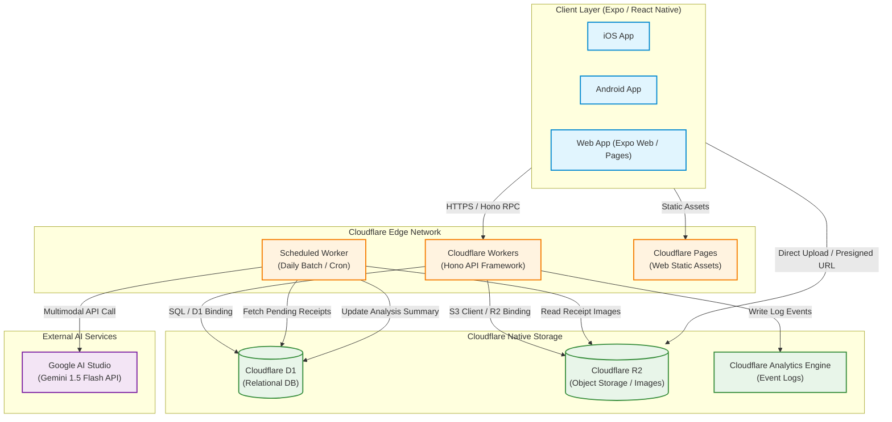
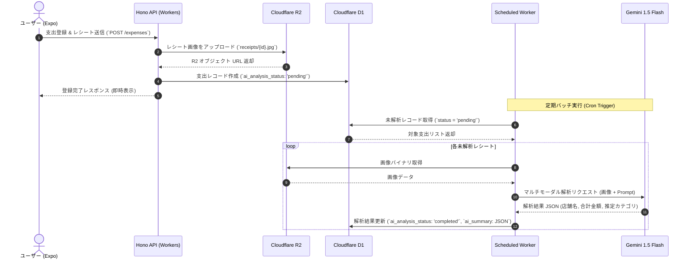
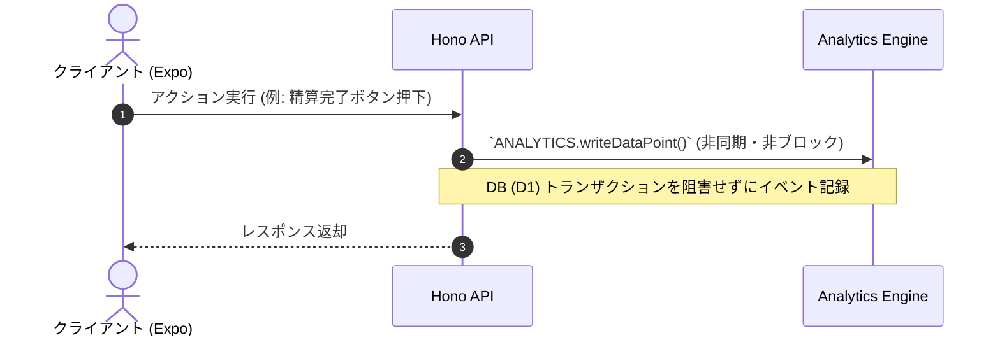

# System Architecture & Infrastructure Specification

> [!info] 概要
> 本ドキュメントは、**Trip Splitter** アプリケーションのシステム全体像、Cloudflare エコシステムを中心としたインフラ構成、データフロー、および外部 API (Gemini 1.5 Flash) との連携アーキテクチャを定義します。
> AI エージェント (Antigravity) がインフラ連携コードや Workers の Bindings 構成を破綻なく実装できるように最適化されています。

---

## 1. 全体システム構成図 (Architecture Diagram)



---

## 2. インフラコンポーネント詳細 & Cloudflare Bindings

> [!note] Bindings 構成 (`wrangler.jsonc` 規定)
> Cloudflare Workers では環境変数の代わりに Bindings を通じて各リソースへ極めて低いレイテンシでアクセスします。

| コンポーネント | 採用技術 / サービス | Binding 名 (`env`) | 役割・用途 |
| :--- | :--- | :--- | :--- |
| **API Server** | Cloudflare Workers (Hono) | - | バックエンド API。認証、CRUD、精算計算ロジックを提供 |
| **Database** | Cloudflare D1 (SQLite) | `DB` | ユーザー、トリップ、立替、精算データの永続化 (`[[database]]`) |
| **Object Storage** | Cloudflare R2 | `BUCKET` | プロフィール画像、トリップカバー、レシート画像の保存 |
| **Analytics Log** | Cloudflare Analytics Engine | `ANALYTICS` | ユーザー行動ログ、API パフォーマンス指標の非同期記録 |
| **Batch Job** | Scheduled Worker (Cron) | - | 夜間・定期実行によるレシート AI 解析タスク処理 |
| **AI Processing** | Gemini 1.5 Flash (Google AI) | `GEMINI_API_KEY` | レシート画像からの金額・店舗名抽出およびカテゴリ自動推定 |

---

## 3. 重要データフロー (Sequence Diagrams)

### 3.1 レシートアップロード & Gemini 1.5 Flash 非同期解析フロー



### 3.2 イベントログ送信フロー (Analytics Engine)



---

## 4. 環境変数 & Cloudflare Bindings 定義 (`wrangler.jsonc`)

AI エージェント (Antigravity) は以下の設定構造に従って `wrangler.jsonc` を生成すること。

```json
{
  "$schema": "node_modules/wrangler/config-schema.json",
  "name": "trip-splitter-api",
  "main": "src/index.ts",
  "compatibility_date": "2026-09-01",
  "compatibility_flags": ["nodejs_compat"],
  "d1_databases": [
    {
      "binding": "DB",
      "database_name": "trip-splitter-db",
      "database_id": "YOUR_D1_DATABASE_ID"
    }
  ],
  "r2_buckets": [
    {
      "binding": "BUCKET",
      "bucket_name": "trip-splitter-assets"
    }
  ],
  "analytics_engine_datasets": [
    {
      "binding": "ANALYTICS",
      "dataset": "trip_splitter_logs"
    }
  ],
  "triggers": {
    "crons": ["0 3 * * *"] 
  }
}
```

---

## 5. セキュリティ & 通信設計規約

> [!warning] Antigravity 実装要件
> 1. **R2 アクセス制御**: 画像の直接パブリック公開は避け、Cloudflare Worker 経由またはカスタムドメイン (`assets.trip-splitter.app`) + Cache API を利用すること。
> 2. **Gemini API Key 秘匿**: API キーはクライアントアプリ（Expo）に埋め込まず、必ず Worker 側の環境変数 (`env.GEMINI_API_KEY`) として管理すること。
> 3. **D1 SQL インジェクション対策**: 生の SQL 文字列結合は一切禁止。Hono + D1 Prepared Statement (`c.env.DB.prepare(...)`) または Drizzle ORM を使用すること。
