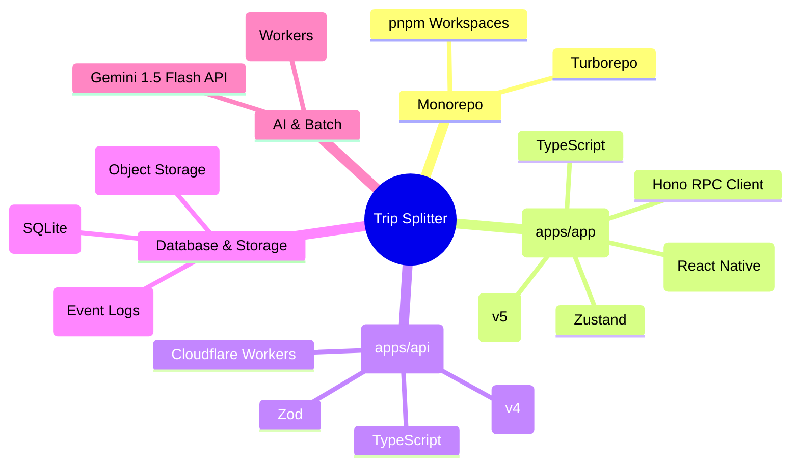

# Tech Stack & Version Constraints Specification

> [!info] 目的 & 概要
> 本ドキュメントは、**Trip Splitter**（旅行立替・精算アプリ）の開発において採用する技術スタック、各種ライブラリのバージョン制約、および AI エージェント (Antigravity) に対する採用技術の制約ルールを定義します。
> 不必要な外部ライブラリの追加や古い API の採用によるハルシネーションを防止することを目的とします。

---

## 1. 全体スキルマップ (Mermaid Mindmap)



---

## 2. カテゴリ別技術スタック & バージョン制約

### 2.1 モノレポ構造 (Workspace & Build)

| 項目 / ツール | 採用バージョン / 仕様 | 役割・用途 |
| :--- | :--- | :--- |
| **Package Manager** | `pnpm` (v9.x) | 依存関係管理・ワークスペース管理 (`apps/`, `packages/`) |
| **Monorepo Manager** | `Turborepo` (v2.x) | パイプラインビルド・キャッシュ制御 (`pnpm build`, `pnpm dev`) |
| **Language** | `TypeScript` (v5.x) | 全パッケージ共通で `strict: true` を適用 |

---

### 2.2 フロントエンド (`apps/app`)

| 項目 / ツール | 採用バージョン / 仕様 | 役割・用途 |
| :--- | :--- | :--- |
| **Framework** | `Expo` (SDK 51+) / `React Native` | モバイルアプリ環境 (iOS / Android) |
| **Routing** | `Expo Router` (v3.x) | File-based Routing (Tab / Stack 画面遷移) |
| **Async State Management** | `TanStack Query` (`@tanstack/react-query` v5) | Hono API 通信のキャッシュ & 再取得管理 |
| **Client UI State** | `Zustand` (v4.x) | モーダル表示状態や一時的フィルター選択の管理 |
| **API Client** | `hono/client` (Hono RPC) | バックエンド `apps/api` の型定義と完全同期した型安全 API 通信 |
| **Validation** | `Zod` (v3.x) | フォーム入力検証 (`packages/shared` のスキーマ再利用) |
| **Icons & UI** | `@expo/vector-icons`, `Lucide React Native` | アイコン表示 |

> [!warning] フロントエンド開発制約 (Antigravity 用)
> - **Redux / MobX / Recoil 等の導入禁止**: クライアント状態管理は `Zustand` と `TanStack Query` のみを使用すること。
> - **直接の `fetch` / `axios` 呼び出し禁止**: 通信は必ず `hono/client` (Hono RPC) を使用して型安全に行うこと。

---

### 2.3 バックエンド (`apps/api`)

| 項目 / ツール | 採用バージョン / 仕様 | 役割・用途 |
| :--- | :--- | :--- |
| **Framework** | `Hono` (v4.x) | Cloudflare Workers 上で動作する超軽量 Web フレームワーク |
| **Runtime** | `Cloudflare Workers` | エッジサーバーレス実行環境 |
| **Schema & Validation** | `Zod` (v3.x) | `zValidator` を使用した Hono リクエストバリデーション |
| **Cron Trigger** | `Workers Cron Triggers` | 日次レシート解析バッチ処理等のスケジュール実行 |

> [!warning] バックエンド開発制約 (Antigravity 用)
> - **Express / Fastify / NestJS の使用禁止**: サーバー実行環境は Cloudflare Workers 上の `Hono` に限定する。
> - **Node.js 固有モジュールの使用禁止**: `fs`, `path`, `child_process` などの Node.js 標準モジュールはエッジ環境で動作しないため使用しないこと。

---

### 2.4 データベース & ストレージ

| サービス | 接続・操作バインディング | 役割・データ保持 |
| :--- | :--- | :--- |
| **Cloudflare D1** | `env.DB` | リレーショナルデータ（ユーザー、旅行、立替、精算履歴）の永続化 |
| **Cloudflare R2** | `env.BUCKET` | アバター画像、旅行カバー画像、レシート画像のオブジェクトストレージ |
| **Analytics Engine** | `env.ANALYTICS` | 画面遷移ログ・操作ログの非同期イベント収集 (SQL D1 から非推奨化) |

---

### 2.5 AI & アナリティクス

| サービス / API | SDK / 接続方式 | 役割・バッチ処理概要 |
| :--- | :--- | :--- |
| **Gemini 1.5 Flash** | `@google/genai` (または REST API) | レシート画像の OCR 解析、品目・金額・カテゴリ推定 |
| **日次バッチ (Daily Batch)** | Cloudflare Workers Cron Trigger | `expenses.ai_analysis_status = 'pending'` のレシートを一括非同期解析 |

> [!tip] AI API コスト最適化ルール
> - レシートアップロード時は即時同期解析を行わず、R2 に保存後に `pending` ステータスで D1 に登録する。
> - Cron バッチ等で夜間にまとめて API 呼び出しを行い、無料枠・低単価帯で運用する。
> - 解析結果は `expenses.ai_summary` にキャッシュし、同一画像の重複解析を防止する。

---

## 3. ディレクトリ構成 & パッケージ依存マトリクス

```
trip-splitter/
├── apps/
│   ├── app/                # Expo Mobile Client
│   │   ├── app/            # Expo Router Pages
│   │   ├── package.json    # expo, react-native, @tanstack/react-query, zustand
│   │   └── tsconfig.json
│   └── api/                # Hono Cloudflare Worker
│       ├── src/
│       │   ├── index.ts    # Hono エントリポイント & RPC Export
│       │   └── routes/     # ドメイン別ルーター
│       ├── wrangler.jsonc  # Cloudflare Bindings (DB, BUCKET, ANALYTICS)
│       └── package.json    # hono, @google/genai, zod
└── packages/
    └── shared/             # Shared Types & Zod Schemas
        ├── src/
        │   ├── index.ts
        │   └── schemas/    # DB & DTO バリデーション
        └── package.json    # zod
```

---

## 4. Antigravity 指示用 チェックリスト

- [ ] 指定のない外部状態管理ライブラリ（Redux 等）を追加していないか？
- [ ] バックエンドコードで Node.js 依存 API (`fs` 等) をインポートしていないか？
- [ ] 型通信において `apps/api` の `AppType` を `apps/app` 側で正確に参照しているか？
- [ ] D1 スキーマへの破壊的変更を行っていないか（変更時は `migrations/` を作成すること）？
